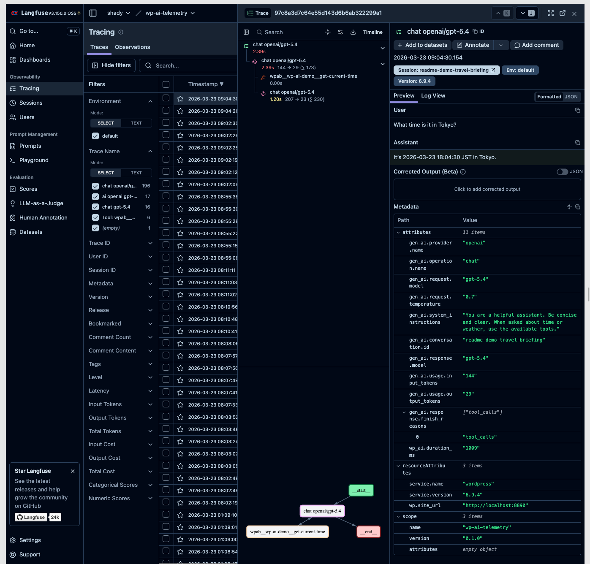

# WP AI Telemetry

[License: GPL v2+](https://www.gnu.org/licenses/gpl-2.0.html)
[PHP 8.1+](https://www.php.net/)

WordPress plugin that instruments **[WP AI Client](https://github.com/WordPress/wp-ai-client)** calls with **OpenTelemetry**, following the [GenAI semantic conventions](https://opentelemetry.io/docs/specs/semconv/gen-ai/). Spans are exported to any OTLP HTTP–compatible backend, such as collectors, SaaS observability stacks, or Langfuse-style hosts. **WP AI Client** ships with **WordPress 7.0+**; on older releases, run the standalone plugin (see [Requirements](#requirements)).



## Why WP AI Telemetry?

WordPress is becoming an AI surface: assistants in the editor, automated content workflows, support bots, and internal tools all call models through WP AI Client. Unlike traditional HTTP requests, those calls are **opaque in server logs**—you see outbound HTTPS, not which model ran, how many tokens burned, whether tools executed, or what the assistant returned. This plugin turns that traffic into **structured, exportable telemetry** (OpenTelemetry + [GenAI](https://opentelemetry.io/docs/specs/semconv/gen-ai/) semantics over OTLP) so you can treat AI like any other production dependency.

### What site owners and enterprises actually need

- **Accountability** — When something goes wrong (bad copy published, a tool fired against production data, a user disputes an answer), you need a **traceable record** of model, messages, tool calls, and outcomes—not a vague “the AI did it.”
- **Governance** — Security and platform teams want to know **which integrations call AI**, from which code paths, with which providers and models, without reading PHP across every plugin.
- **Spend control** — Token and request volume are **direct costs**. Without per-route or per-feature signals, you cannot attribute spend, set budgets, or justify model upgrades.
- **Reliability** — Latency, error rates, and provider-specific failures belong in the same dashboards as the rest of your observability story, especially as AI moves from experiments to **production dependencies**.
- **Iterative development** — Monitor how prompts scale, how workflows perform, and how models perform over time, so you can calibrate them based on real-world data and metrics.

### What questions this integration can answer

- **What's burning through my AI budget?**
- **Is this workflow efficient? Is it using the right model?**
- **Is this model working better than the previous one?**
- **Can we understand which workflows are costing us the most?**
- **Which workflow exposed our private data to the model?**

## Requirements

- WordPress **6.8+** (this plugin’s minimum; you still need WP AI Client available—see below)
- PHP **8.1+**
- **WP AI Client** plus an AI **provider** plugin (e.g. OpenAI) so calls can run:
  - **WordPress 7.0+** — WP AI Client is **bundled in core**; enable it per core docs and add a provider.
  - **WordPress 6.x** — Install and activate the **[standalone WP AI Client](https://github.com/WordPress/wp-ai-client)** plugin (and a provider).
- **Event hooks** — This plugin listens to `wp_ai_client_before_generate_result` and `wp_ai_client_after_generate_result`. Those only fire if the client wires the SDK `PromptBuilder` to WordPress’s `EventDispatcher`. Follow **[WordPress/wp-ai-client#67](https://github.com/WordPress/wp-ai-client/pull/67)** (see also [issue #66](https://github.com/WordPress/wp-ai-client/issues/66)): use a **WP AI Client build that includes that fix** (core release or standalone plugin version), or apply an equivalent patch until it ships. Without it, telemetry will not record inference.
- An **OTLP HTTP** endpoint (and **Basic Auth** credentials) from your observability stack, ready to accept traces.

**Release packages** ship OpenTelemetry PHP dependencies only (`vendor/`). **WP AI Client is not bundled**, so it cannot clash with core’s client on WordPress 7.0+ or with a separately installed standalone plugin.

## Quick installation

You already have an OTLP-compatible backend (endpoint URL and, if required, username and password). Then:

1. **Download** the latest release zip from [GitHub Releases](https://github.com/shadyvb/wp-ai-telemetry/releases) (asset `wp-ai-telemetry.zip`).

2. **Upload, install, and activate** **WP AI Telemetry** under `wp-content/plugins/`.

3. **Provide WP AI Client** (not included in the zip):
   - **WordPress 7.0+** — Use the client bundled with core; ensure your WordPress version includes the EventDispatcher wiring from [PR #67](https://github.com/WordPress/wp-ai-client/pull/67) (or equivalent) so hooks fire.
   - **WordPress 6.x** — Install and activate the **[standalone WP AI Client](https://github.com/WordPress/wp-ai-client)** plugin and a provider. Use a release **with the same fix** as [PR #67](https://github.com/WordPress/wp-ai-client/pull/67), or patch your install. For the Composer patch this repo uses in development, see **[CONTRIBUTING.md](CONTRIBUTING.md)**.

4. **Configure export** — either:
   - **Settings → AI Telemetry** — enable telemetry, paste the OTLP HTTP **base URL** (the plugin appends `/v1/traces`), and add Basic Auth if your collector needs it; or
   - **`wp-config.php`** — define `WP_AI_TELEMETRY_ENABLED`, `WP_AI_TELEMETRY_OTLP_ENDPOINT`, and `WP_AI_TELEMETRY_OTLP_AUTH_USER` / `WP_AI_TELEMETRY_OTLP_AUTH_SECRET` (see [Configuration](#configuration)).

Trigger AI calls through WP AI Client; with hooks working and OTLP configured, traces should appear in your backend.

## Configuration

### wp-admin

Go to **Settings → AI Telemetry**:


| Setting                                 | Purpose                                                                                                                                                                                                                                                               |
| --------------------------------------- | --------------------------------------------------------------------------------------------------------------------------------------------------------------------------------------------------------------------------------------------------------------------- |
| **Enable Telemetry**                    | Master switch; when off, no spans are created.                                                                                                                                                                                                                        |
| **OTLP HTTP endpoint**                  | Base URL only; the plugin appends `/v1/traces`. Must be `http` or `https`.                                                                                                                                                                                            |
| **OTLP Basic Auth username / password** | Sent as `Authorization: Basic …` on export requests.                                                                                                                                                                                                        |
| **Sampling rate**                       | `0.0`–`1.0` fraction of traces (parent-based sampler).                                                                                                                                                                                                                |
| **Log prompts & responses**             | Controls `gen_ai.tool.call.arguments` and `gen_ai.tool.call.result` on tool spans. Inference spans still record `gen_ai.input.messages` and `gen_ai.output.messages` for trace UIs; disable this checkbox if tool payloads must not leave the server. |

### wp-config.php (optional)

These **global constants** override stored options when defined (useful for secrets, CI, and immutable deploys):

| Constant | Effect |
| -------- | ------ |
| `WP_AI_TELEMETRY_ENABLED` | Master switch (`true` / `false`). |
| `WP_AI_TELEMETRY_OTLP_ENDPOINT` | OTLP HTTP base URL (non-empty string only). |
| `WP_AI_TELEMETRY_OTLP_AUTH_USER` | Basic Auth username. |
| `WP_AI_TELEMETRY_OTLP_AUTH_SECRET` | Basic Auth password (recommended so the password is not only in the database). |
| `WP_AI_TELEMETRY_SAMPLING_RATE` | Float `0.0`–`1.0`. |
| `WP_AI_TELEMETRY_LOG_PROMPTS` | Tool args/results logging (`true` / `false`). |
| `WP_AI_TELEMETRY_OTLP_HTTP_TIMEOUT` | OTLP HTTP client timeout in seconds (default `10`, clamped between `0.5` and `120`). |
| `WP_AI_TELEMETRY_GEN_AI_ATTR_MAX_BYTES` | Max byte length for large GenAI attributes such as message JSON (default `65536`, minimum `1024`). |
| `WP_AI_TELEMETRY_RESOURCE_INCLUDE_SITE_URL` | Set to `false` to omit `wp.site_url` from the OTel resource. |

Implementation: `includes/Settings.php` (option key `Settings::OPTION_KEY`; wp-config overrides are driven by a single internal map and type casting, and `otlp_http_timeout` is clamped to **0.5–120** seconds when merging).

### APIs

#### Session API (optional)

To use your own conversation id (e.g. workflow, plugin, or user session):

```php
$session_id = \WP_AI_Telemetry\Session::start(); // or Session::start( 'my-id' );
// ... WP AI Client calls ...
\WP_AI_Telemetry\Session::end();
```

#### Metadata API (optional)

To use custom metadata for the session:

```php
$session = \WP_AI_Telemetry\Session::start();
// Add metadata to the session
\WP_AI_Telemetry\Session::merge_metadata(
	array(
		'wp_ai.workflow' => 'my-plugin/action',
		'user.id'        => 123,
	)
);
// ... WP AI Client calls ...
\WP_AI_Telemetry\Session::end();
```

`Session::start()` clears any previous session metadata bag; call `merge_metadata()` **after** `start()`. Use `Session::is_active()` to test whether a session is open. Metadata is merged onto the **root** inference span of each trace only (not child agentic turns or `execute_tool` spans). Keys starting with `gen_ai.` are ignored. At most **16** keys are exported; each string value is capped at **2048** UTF-8 bytes (see `\WP_AI_Telemetry\RootSpanAttributes`). The measured `wp_ai.duration_ms` attribute is always set in the after hook and overwrites any value set only in `before`.

### Filters


| Filter                                      | Default | Purpose                                                                                                                                                                                                         |
| ------------------------------------------- | ------- | --------------------------------------------------------------------------------------------------------------------------------------------------------------------------------------------------------------- |
| `wp_ai_telemetry_auto_conversation_session` | `true`  | When truthy and no session is open, the first instrumented AI call per request calls `Session::start()` with a random id. Return `false` to set `gen_ai.conversation.id` only when you call `Session::start()`. |
| `wp_ai_telemetry_gen_ai_attribute_max_bytes` | `65536` (or `WP_AI_TELEMETRY_GEN_AI_ATTR_MAX_BYTES`) | Max byte size for large `gen_ai.*` string attributes (messages, system instructions, tool payloads). Minimum enforced: `1024`. |
| `wp_ai_telemetry_root_span_attributes` | Session metadata snapshot | **Root inference span only.** `( array $attributes, array $context ): array`. Adds OTLP span attributes (string, int, float, bool). `$context` includes `event`, `model`, `correlation_id`, `session_id`, `is_trace_root`, `capability`, `operation`, `provider_id`, `request_model_id`, `span_name`. |

Constants: `\WP_AI_Telemetry\Telemetry::FILTER_AUTO_CONVERSATION_SESSION`, `FILTER_GEN_AI_ATTRIBUTE_MAX_BYTES`, `FILTER_ROOT_SPAN_ATTRIBUTES`.

## Architecture (overview)

1. Callers use WP AI Client (e.g. `wp_ai_client_prompt( … )->generate_text_result()`).
2. The client dispatches **before** / **after** generate events → WordPress actions `wp_ai_client_before_generate_result` and `wp_ai_client_after_generate_result`.
3. **Telemetry** opens and closes OTel spans, sets GenAI attributes, correlates before/after with `spl_object_id( $model )`, and keeps agentic turns in one trace via a carried span scope (shared UTF-8 / control-character helpers live in `includes/StringUtils.php`).
4. **OtlpTracerProvider** registers a global `TracerProvider` that exports completed spans over OTLP HTTP (protobuf); sampling uses OpenTelemetry’s `ParentBased` sampler wrapping a **trace-ID ratio** sampler at your configured rate (including `1.0` for “sample all roots” in normal use).
5. `plugin.php` loads the bundled WP AI Client when core does not already provide it (`maybe_load_standalone_ai_client()`), registers admin from `init_admin()`, and flushes exports on shutdown via `safe_flush()` so export failures never take down the request.

## Contributing

Issues, PRs, development setup, linting, tests, and Composer/upstream patch notes are in **[CONTRIBUTING.md](CONTRIBUTING.md)**. Agent-focused shortcuts and repo rules are in **[AGENTS.md](AGENTS.md)**.

## License

GPL-2.0-or-later. See [composer.json](composer.json) and plugin headers in [plugin.php](plugin.php).

## Links

- Composer package name: `wordpress/wp-ai-telemetry` (see [composer.json](composer.json))
- [OpenTelemetry GenAI semantic conventions](https://opentelemetry.io/docs/specs/semconv/gen-ai/)
- [OTLP HTTP](https://opentelemetry.io/docs/specs/otlp/#otlphttp-request)
